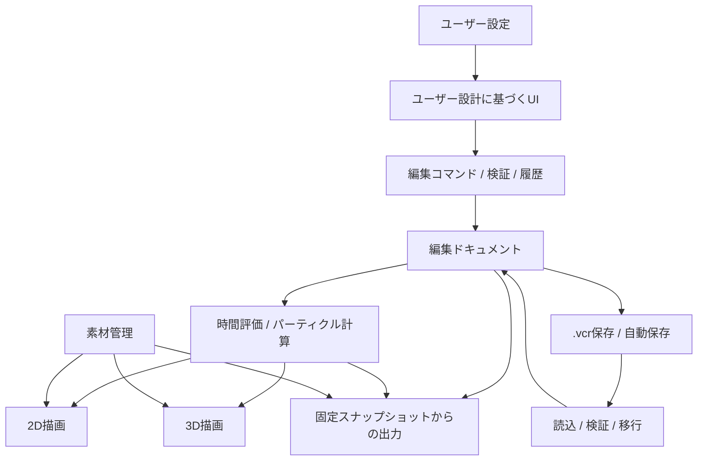

# VFXCraft アーキテクチャ

版: 1.0 / 2026-11-03  
**本書のモジュール構成・状態設計・処理方式は設計提案。** 製品要件は[PROJECT_SPEC.md](PROJECT_SPEC.md)に従う。ライブラリ、描画基盤、保存コンテナは未選定。

## 1. 設計上の狙い

2D/3D、階層、時間変化、Undo/Redo、保存・復元を同じ編集データから動かす。UIの配置が変わっても、編集や描画の実装を作り直さずに済む責務分割を目指す。

この図はデータと処理の関係であり、画面上の配置ではない。

## 2. 責務と依存方向

| モジュール | 責務 | 境界 |
| --- | --- | --- |
| domain | プロジェクト、レイヤー、親子関係、エミッター、材質、トラック、素材参照の型と制約 | UI・描画API・ブラウザ保存に依存しない |
| commands/history | 編集操作の実行・検証・Undo/Redo・操作の集約 | UIからの変更を共通経路へ集める |
| timeline | 開始時間、キー補間、フレーム変換、再生状態 | 画面のタイムライン表現と分離 |
| simulation | 連続/Burst、粒子寿命、発生・更新、時刻への評価 | レンダリングFPSに依存しない時間進行 |
| render-2d | 通常/ピクセル2D、合成、グラデーション、基本Bloom | 編集ドキュメントを直接変更しない |
| render-3d | 3D粒子、ビルボード、透明合成、基本Bloom、カメラ | 同上。3D固有座標を扱う |
| assets/presets | 画像デコード、素材ID、内蔵・自作プリセット、参照整合性 | 素材データと編集参照を分ける |
| persistence | `.vcr`、自動保存、検証、バージョン移行 | ドメインと保存コンテナの相互変換 |
| export | PNG連番、シート、3D JSON | 編集状態から独立した出力ジョブ |
| preferences/i18n/help | テーマ、日英、プレビュー設定、説明・操作一覧 | プロジェクト本体と別に保持 |
| presentation | 選択・入力・状態表示・ユーザー設計の画面 | 操作はコマンドへ、表示は読み取りモデルから |

物理ディレクトリやパッケージ数は実装規模に合わせる。この責務表を根拠に過剰な分割をしない。

## 3. 状態を分ける

| 状態 | 内容 | 保存先の提案 |
| --- | --- | --- |
| ProjectDocument | モード、時間設定、レイヤー、階層、エミッター、材質、キー、素材参照 | `.vcr`、自動保存 |
| AssetStore | インポート画像・内蔵素材のデータとメタ情報 | `.vcr`で対象プロジェクトの全登録インポート画像を同梱、自動保存にも対応 |
| EditorSession | 現在の選択、再生位置、開いている編集操作、履歴 | 原則一時状態。保持範囲は別途決定 |
| SimulationState | 実行中粒子、乱数状態、キャッシュ、統計 | 再計算可能な一時状態 |
| UserPreferences | テーマ、言語、プレビュー設定 | ブラウザ内、プロジェクトとは別 |
| ExportJob | 入力スナップショット、設定、進捗、結果 | 一時状態 |

プロジェクトを開いてもユーザーの言語・テーマを強制変更しない。履歴やGPUオブジェクト、実行時のURLを保存データに混ぜない。

## 4. データモデルの案

- `Project`: 安定ID、形式バージョン、編集モード、時間設定、レイヤー集合、素材一覧。
- `Layer`: 安定ID、名前、親ID、兄弟内順序、表示/ロック、変換、開始時間、コンテンツ種別。
- `Group`: 子をまとめる階層ノード。必ずしも粒子を生成しない。
- `Emitter`: 連続/Burstの設定、粒子設定、材質参照。モード固有値は明示する。
- `Material` はテクスチャ参照、通常・加算・乗算、基本色・透明度、寿命・空間グラデーション、発光強度を持つ。
- `Track`: 対象ID、対象プロパティ、キー列、補間方式。
- `Asset`: 安定ID、メディア型、表示名、寸法、格納参照、必要なら内容ハッシュ。
- `Preset`: 対応モード、編集可能なテンプレート、必要素材、表示用情報。

具体的なフィールド、初期値、許容範囲はT02でスキーマと設計記録にする。架空の上限値を確定仕様として追加しない。

### 2Dと3D

1つのプロジェクトに1つの編集モードを持たせる。モードの違いは型で区別し、2DのZ値等を暗黙に補って変換しない。相互変換・混在は別の製品判断が必要。座標・時間・キーの契約は[ADR-003](architecture/ADR-003.md)に従う。

### 時間・再現性

- 制作時間、粒子寿命内時間、プレビュー実時間、出力フレーム時刻を区別する。
- 固定時間ステップとシード付き乱数を提案する。同じデータ・シード・フレーム時刻から同じ挙動を再現し、スクラブと出力を照合しやすくする。
- シーク時は先頭から評価するかチェックポイントから再計算する。逆方向へ単純な負の時間更新を流さない。
- 内部時間単位と制作FPSの対応、範囲の終端規則、キー補間はADRで決める。
- プレビュー速度は見せる速さだけを変え、保存キーや出力FPSを変更しない案を採る。
- 異なるGPU間の画素単位一致までは保証しない。検証には許容差と基準環境を定める。

## 5. 履歴・階層・スナップ

### Undo/Redo

最大100操作の履歴と編集コマンドの設計は[ADR-005](architecture/ADR-005.md)で定める。

- 編集コマンドは検証→実行→履歴登録の順で処理し、無効操作は履歴を消費しない。
- Undoスタックは最大100件。101件目で最古を除外する。Undo後の新規編集でRedoを破棄する。
- レイヤー、キー、素材参照、パラメータ、階層の変更を対象にする。
- ドラッグと数値入力の途中更新は、確定時に最大1操作へ集約する。取消では開始状態へ戻す。
- 文書の変更されていない部分を共有するスナップショットを使う。画像本体は素材ストアが管理し、履歴が必要とする間は素材を回収しない。
- 新規作成と別プロジェクト読込で履歴を初期化する。再生、プレビューカメラ、テーマ変更は編集履歴の対象外とする。
- 保存済み判定は履歴件数ではなく、保存した編集状態との対応で行う。Undoで保存状態へ戻った場合も正しく示す。

### 階層

- ID参照でツリーを構成し、自己親・循環・存在しない親・重複IDを拒否する。
- 親の移動・回転・サイズが子へ伝わる変換モデルを提案する。
- 再親子化は現在時刻のワールドTRSを維持し、表現不能な変換を拒否する。[ADR-012](architecture/ADR-012.md)にアニメーションとロックの扱いを記録する。
- 親削除、子の複製、グループ解除、親ロック/非表示の継承、開始時間の継承は未決。UI表示と保存値を実装前に一致させる。
- 複製で新しいIDを発行し、内部の子・キー参照を書き換える。素材参照は共有可能。
- 3Dの深度・透明描画順を、レイヤー一覧の順序と混同しない。合成規則を検証する。

### スナップ

位置スナップは数値入力・ドラッグ・コマンドから共通関数を使う。WorldまたはParent Localで、2D・3Dに独立した間隔を持たせる。時間スナップはT08のドラッグだけに適用する。

## 6. 保存・自動保存・出力

[PROJECT_FORMAT.md](PROJECT_FORMAT.md)を保存契約の設計案とする。

- 手動保存・自動保存・プリセットで共通の検証処理を利用する。
- 読込は一時領域で完全検証し、成功してから編集中の状態と置き換える。
- 自動保存はブラウザの構造化ストレージを使う案。データと素材の整合性が保たれる単位で世代を書き込む。
- 自動保存間隔、世代数、対象プロジェクト数、容量上限はT11前に決定する。容量不足・保存失敗を成功表示しない。
- 画像出力は開始時点のプロジェクト・素材を固定し、専用の時間評価で生成する。画面の実測FPSや再生停止に依存しない。
- PNG連番はフレームごと、シートは同じフレームをタイル化する。範囲・終端・余白・上限を定義する。
- 透過指定時は出力用のアルファとBloomの相互作用を検証する。背景チェッカーや操作補助を混入させない。
- 3D JSONは保存ドキュメントの意図的な変換結果。内部UI状態や秘密情報を含めない。

## 7. 技術選定と未決事項

特定フレームワークや製品の最新仕様には依存せず、ここでは選定条件を定義する。実装着手時に必要な公式資料を確認し、採用バージョンを固定する。

| 設計記録 | 決める内容 | 検証の観点 |
| --- | --- | --- |
| ADR-001 | 言語、UI基盤、ビルド・テスト手段 | 型/検証、UI分離、保守性、実行可能な最小構成 |
| ADR-002 | 2D/3D描画基盤、必要なブラウザ機能 | ピクセル、アルファ/加算、ビルボード、基本Bloom、透過出力 |
| ADR-003 | 編集モデル、モード、時間、座標、キー補間 | 往復保存、シーク再現、単位、3D JSONとの対応 |
| ADR-004 | `.vcr`コンテナ、バージョン、素材、自動保存 | 再編集、容量、検証、復元、移行 |
| ADR-005 | 階層、ロック、操作単位、スナップ | Undoで一貫して戻るか、循環、変換継承 |
| ADR-006 | 出力契約、制限、3D JSONスキーマ | 終端、シート配置、素材参照、失敗/取消 |
| ADR-007 | 対応ブラウザ、基準端末、性能目標 | 代表プロジェクトで測定した実測値 |

ADRは採用理由・代替案・検証結果・未解決点を短く残す文書。内部実装の通常判断はCodexが進めて記録する。UI配置や製品スコープの変更を技術判断に紛れ込ませない。

## 8. 将来のAI接続

MVP-BではAI接続を実装しない。編集ドキュメントの構造化、検証、共通コマンドを整えれば将来追加できる。

将来案: 共通接続インターフェース→クラウドAPI→ローカルLLMの順に追加。AIの提案を構造化差分として検証し、ユーザーが確認してから1つの編集操作として適用する。拒否時は未変更、適用後はUndo可能とする案。APIキーの保管、接続プロキシ、料金、ローカル接続許可はその段階で設計し、MVP-Bへ先行導入しない。

## T00採用事項（2026-11-03追記）

過去の本文・決定の履歴を保持し、今回のユーザー決定を以下に追加する。

- 仕様・設計・計画の正本はdocs/、AGENTS/README/.gitignoreはルート、PRテンプレートは.github/に置く。
- [UI v0.1](design/ui/v0.1/README.md)を採用済み。「UI資料未受領」「配置待ち」は作成時点の記述であり、現在は参考画像受領済み・詳細配置未確定。重要な変更は事前許可を得る。
- 初期検証はWindows 11、Chrome/Edge、キーボード・マウス、デスクトップ。Firefox/Safari/タッチは将来検討。性能・最低版・画面寸法は未測定・未決。
- [開発運用](DEVELOPMENT_WORKFLOW.md)と[追跡表](REQUIREMENTS_TRACEABILITY.md)を参照。T00のみ許可。文中の開始・継続例からT01以降へ自動着手しない。

## T04〜T10の設計上の境界（2026-11-07）

[仕様正本](PROJECT_SPEC.md)のタスク別決定を適用する。T03の親ID変更・子付き親削除拒否は基盤操作として残り、T09では現在時刻でのワールド変換維持、子孫の保護、削除・解除の原子的な編集を設計する。開始時刻は親子で独立し、表示・色・透明度と編集ロックの継承は階層から導出する。粒子シミュレーション空間と位置スナップ空間は別の設定とする。発生期間とキーの有効範囲も分ける。プレビュー品質を変えてもプロジェクトの保存値や出力評価は変えない。

## T05の2D評価・描画
解析的な時刻評価とCanvas描画を分離した。採用理由、空間・単位、資源の所有と性能上の制約は[ADR-008](architecture/ADR-008.md)。

## T06の3D評価と描画
全発生器を横断する粒子単位の深度ソート、再利用頂点バッファ、独立したカメラ状態と入力を[ADR-009](architecture/ADR-009.md)に記録。カメラの全体表示は現在時刻の生存粒子を基準にする。

## T07のマテリアル描画
T07検証では、共通の材質評価とGPUシェーダーへ2D正射影と3D透視投影の頂点を渡す。本体と発光を別パスに分け、背景は本体側でだけ使う。T05/T06の評価器とカメラを再利用する。合成式、色・アルファ、資源の所有と制約は[ADR-010](architecture/ADR-010.md)を参照。

## T08の時刻評価
[ADR-011](architecture/ADR-011.md)で、区間補間と発生率の積分、発生時の値と現在値、再生時計・文書履歴・GPU描画の境界を定義する。

## T09の階層編集
既存の親子参照に基づき、行列・表示・色・Alphaを反復評価する。編集コマンドは自身と祖先のロックを確認し、共有する設定も保護する。[ADR-012](architecture/ADR-012.md)を参照。

## T10 正式UIの統合

[ADR-013](architecture/ADR-013.md)に共通セッション、パネル配置、ショートカット、Auto Keyと復元の境界を記録する。正式プレビューとタイムラインは同じ文書・履歴・プレイヘッドを使い、毎フレームのReact再構築を避ける。自動保存の基礎実装はユーザー承認でT11からT10へ移す。
