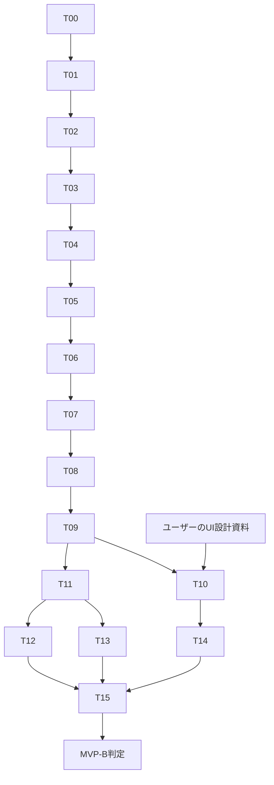

# VFXCraft 開発計画

版: 1.0 / 2026-11-03  
この工程分割は実装計画の提案。MVP-Bの製品スコープは変更しない。

## 1. 進め方

最初に1つの効果を「作成→編集→保存→開き直す→出力」できる小さな流れを通し、その後で機能を広げる。各段階で動く状態を維持する。早い段階で保存・履歴・時間モデルを扱い、最後に後付けしない。

2Dだけの中間版、プリセットが数個の検証版を作ってよい。ただしそれらは**開発途中の到達点**であり、MVP-Bの代わりにはならない。50種類以上のプリセット、3D、階層、基本Bloom、自動保存等を省略したままMVP-B完成としない。

## 2. 開発フェーズ

| 段階 | 対応タスク | 作るもの | 完了条件 |
| --- | --- | --- | --- |
| P0 要件・技術検証 | T00〜T01 | 要件対応、最小実行環境、描画/透過/保存の検証、ADR初版 | 必須要件を失わない構成を選定。UI位置は未確定のまま |
| P1 編集・保存の基盤 | T02〜T04 | ドキュメント、操作履歴、素材参照、`.vcr`最小往復 | 2D/3Dの基礎データを編集し、Undo/Redoと保存/読込で保持 |
| P2 描画 | T05〜T07 | 連続/Burst、通常/ピクセル2D、3D/ビルボード、合成/グラデーション/基本Bloom | 両モードの代表効果を検証用UIで再生 |
| P3 時間・階層編集 | T08〜T09 | タイムライン、全必須キー、再生、階層、両スナップ | 時間と親子変換が履歴・保存・描画で一致 |
| P4 製品UI・作業保持 | T10〜T11 | ユーザー設計のUI、ショートカット、完全保存、自動保存/復元 | 仮画面から移行し、制作作業を再開可能 |
| P5 制作素材・出力 | T12〜T13 | 50種類以上、自作プリセット、全画像形式、画像/JSON出力 | プリセットから編集して各形式で出力できる |
| P6 環境・品質 | T14〜T15 | 日英/テーマ/保持/ヘルプ、全体受け入れ、性能測定 | 必須検収完了、重大不具合解消、MVP-B判定 |
| P7 MVP-B後 | F01〜F04 | 任意の次期開発 | MVP-B完成後に別計画で着手 |

詳しい変更範囲と依存関係は[CODEX_IMPLEMENTATION_PLAN.md](CODEX_IMPLEMENTATION_PLAN.md)を参照。

## 3. UI設計と開発の合流

ユーザーは[UI_LAYOUT_WORKSHEET.md](UI_LAYOUT_WORKSHEET.md)または独自の資料で配置を設計する。CodexはUIに依存しないP0〜P3を進め、機能単位の操作・状態を確認できるようにする。

T10はユーザーの配置資料が必要。未受領なら配置を決めず、T11の保存内部処理、T12のプリセットデータ、T13の出力処理、T14の翻訳・ヘルプ原稿など依存しない範囲を進める。UIが必要な部分だけを保留として残す。

## 4. 主要な依存関係

この図は統合の主な依存関係。プリセット原案、翻訳、テスト用データなどの準備は必要な前提がそろった範囲で先に進めてよい。日数・人数・締切は指定されていないため、確約する日程は置かない。T01後に実測に基づき見積もる。

## 5. 各段階で確認する制作例

| 到達点 | 確認する例 |
| --- | --- |
| 最小往復 | 素材を参照するレイヤーを変更→Undo/Redo→`.vcr`保存→開く |
| 2D描画 | 連続する光粒子とBurstの重ね合わせ。通常/ピクセル両方で確認 |
| 3D描画 | 3Dの粒子群をビルボードで表示し、カメラを操作 |
| 時間・階層 | 親を動かし、子の色/透明度をキーで変化させ、開始時間とスナップを確認 |
| 永続化 | 両モードで階層・キー・素材を保存、自動保存からも復元 |
| 出力 | 2Dを透過PNG連番/シート、3Dを設定JSONへ出力 |
| 完成判定 | 50種類以上と自作プリセットを日英・両テーマで使用し、一連の制作が通る |

例の内容・名称は検証用の提案であり、収録プリセットのリストではない。

## 6. 手戻りが大きい点への対応

| 不確定要素 | 先に行う作業 |
| --- | --- |
| 透過と基本Bloom、ピクセル描画の相性 | T01/T07で小さな画像出力まで検証 |
| 階層とキーと履歴の整合 | T02/T03でデータ制約、T09で変換・削除・複製を確認 |
| シークと画像出力の差 | 時間評価器を共通化し、固定条件で比較 |
| 素材を含む保存と容量 | T04で往復、T11で自動保存/中断/容量不足を検証 |
| 50種類以上の制作量 | T12前に収録リストと素材利用条件を整え、制作例ごとに検収 |
| UI設計の受領時期 | 内部ロジックを分けて進め、配置が必要な統合だけを待つ |

## 7. MVP-B後の候補計画

| ID | 内容 | 位置付け |
| --- | --- | --- |
| F01 | キーフレーム対象を発生量・速度などへ拡張 | 将来の確定方向。詳細計画は別途 |
| F02 | トレイル、メッシュ粒子、カスタムシェーダー、高度Bloom | 将来の拡張。順序未決 |
| F03 | AI生成・編集・助言。クラウドAPI→ローカルLLM | MVP-B完成後。確認後に適用する方式 |
| F04 | デスクトップアプリ | 将来。梱包・保存方式等は別設計 |

カーブエディタは余裕があれば追加する任意機能。SQLiteは採用未定の検討対象。Unity等の専用連携は元チャットの開発案には現れるが、確定要件として今回の将来計画に追加しない。

## T00採用事項（2026-11-03追記）

過去の本文・決定の履歴を保持し、今回のユーザー決定を以下に追加する。

- 仕様・設計・計画の正本はdocs/、AGENTS/README/.gitignoreはルート、PRテンプレートは.github/に置く。
- [UI v0.1](design/ui/v0.1/README.md)を採用済み。「UI資料未受領」「配置待ち」は作成時点の記述であり、現在は参考画像受領済み・詳細配置未確定。重要な変更は事前許可を得る。
- 初期検証はWindows 11、Chrome/Edge、キーボード・マウス、デスクトップ。Firefox/Safari/タッチは将来検討。性能・最低版・画面寸法は未測定・未決。
- [開発運用](DEVELOPMENT_WORKFLOW.md)と[追跡表](REQUIREMENTS_TRACEABILITY.md)を参照。T00のみ許可。文中の開始・継続例からT01以降へ自動着手しない。
